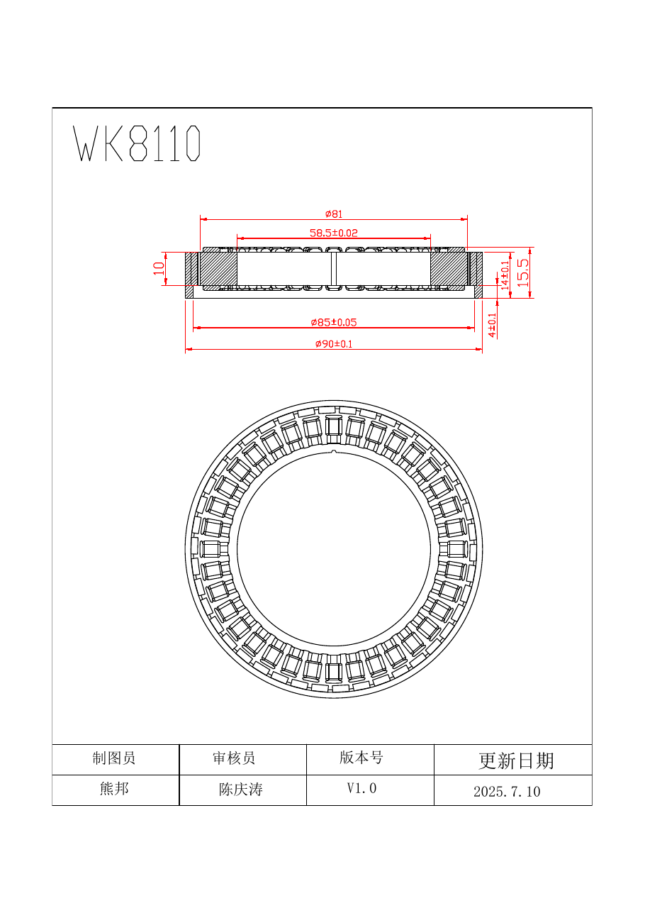

# 00 - The big picture

## What the board has to do

A robotic actuator controller turns **a command** ("hold 37.2 degrees", "give me
4 N·m", "spin at 2 rad/s") into **three precisely shaped motor currents**, using
**measurements** (rotor angle, phase currents, bus voltage, temperature) to
close the loop, and **protects itself and the motor** when things go wrong.

Everything on the PCB serves one of these jobs:

| Job | Blocks on the PCB |
|-----|-------------------|
| Bring energy in safely | Connector, reverse-polarity protection, TVS, bulk capacitors, fuse/eFuse |
| Turn DC into 3-phase AC | 6 MOSFETs (3 half-bridges), gate driver, bootstrap caps |
| Measure what is happening | Current shunts + amplifiers, bus voltage divider, NTC thermistors, encoder(s) |
| Think | MCU (your ESP32-S3), crystal, logic power supplies |
| Talk | CAN / RS-485 transceiver, USB-C, UART |
| Help humans | LEDs, test pads, programming/boot buttons, ID switches/jumpers |
| Survive | Thermal path to the housing, layout that keeps noise out of measurements |

## Block diagram

```
                 24 V battery / PSU
                        |
        +---------------v----------------+
        | POWER INPUT                    |
        |  connector (XT30)              |
        |  reverse-polarity protection   |
        |  TVS clamp, bulk + MLCC caps   |      ("DC bus" / "DC link" = this 24 V node)
        +------+-------------------+-----+
               |                   |
               |            +------v---------------+
               |            | LOGIC SUPPLIES        |
               |            | 24V -> 5V/12V (buck)  |
               |            | -> 3.3V (LDO or buck) |
               |            +------+---------------+
               |                   | 3.3 V
   +-----------v-----------+   +---v-----------------------------+      +-------------+
   | POWER STAGE           |   | ESP32-S3                         |<---->| USB-C       |
   |  3x half-bridge       |<--|  MCPWM (6 PWM + dead time)       |      | flash+serial|
   |  (6 N-MOSFETs)        |   |  ADC / SPI ADC for currents      |      +-------------+
   |  gate driver +        |   |  SPI to encoder(s)               |      +-------------+
   |  bootstrap            |   |  TWAI (CAN) / UART (RS-485)      |<---->| CAN / 485   |
   +----+-----+-----+------+   |  GPIO: LEDs, fault, enable       |      | transceiver |
        |     |     |          +---^-----------^----------^-------+      +-------------+
        U     V     W              |           |          |
        |     |     |        currents     angle(s)    temps, Vbus
   +----v-----v-----v---+          |           |          |
   |  WK8110 MOTOR      |   +------+-----+  +--+-------+  +--+------------+
   |  (3 windings)      |   | shunts +   |  | magnetic |  | NTCs (FETs,   |
   +--------------------+   | amplifiers |  | encoder  |  | motor), Vbus  |
                            +------------+  +----------+  | divider       |
                                                          +---------------+
```

## The one loop that matters most: the current (torque) loop

Torque of a BLDC is proportional to current: **T = Kt × Iq**. So a precise
actuator is, at its heart, a precise *current controller*. Every ~50 µs
(20 kHz) the MCU must:

1. Sample the phase currents **exactly** in the middle of the PWM period (when
   the measurement is clean).
2. Read the rotor angle from the encoder.
3. Do the FOC math (Clarke, Park, two PI controllers, inverse Park, SVPWM).
4. Write new duty cycles to the three half-bridges.

Slower loops (velocity ~1-5 kHz, position ~0.5-2 kHz) sit around it. If the
inner current loop is noisy, nothing outside it can be precise. That is why
half of these notes are about **measurement quality**: current sensing, encoder
quality, noise and layout.

## Energy vs information

A useful way to look at any controller board:

- **Energy path** (thick copper, big parts): connector -> caps -> MOSFETs ->
  motor -> shunts -> back to ground. Tens of amps, switching in nanoseconds.
  It is *loud*: it radiates magnetic and electric noise.
- **Information path** (thin traces, tiny parts): shunt amplifier, encoder,
  MCU, crystal, transceivers. Millivolts and microamps. It is *sensitive*.

Good boards keep these physically separated and only let them meet at
controlled points (the shunt sense lines, the gate drive lines). Look at the
annotated photos in [13](13_Reference_Boards_Explained.md): on every board the
MOSFETs sit on one side and the MCU on the other.

## Your motor: WK8110 (from `CAD/References/WK8110-2D-Drawing.pdf`)



What the drawing tells us:

- Stator outer diameter about 81 mm, housing ring OD 85-90 mm, stator stack
  ~10 mm, total height 15.5 mm.
- Rotor inner bore **58.5 mm**: it is a *frameless* motor - no shaft and no
  bearings come with it. You design the shaft, bearings, and **where the
  encoder magnet sits** (important for module 06: the centre of the motor is a
  big hole, so you either put a magnet on a central shaft/hub or use an
  off-axis/ring encoder).
- The drawing shows the stator with many teeth. Motors of this size class are
  very often 36 slots / 42 magnets = **21 pole pairs**, but **count or measure
  yours** (procedure in module 02) - the pole pair count goes directly into
  the firmware.

What the drawing does *not* tell you and you must measure or get from the
seller: phase resistance, phase inductance, Kv (or Kt), rated/peak current.
Typical numbers for this class at 24 V are roughly 0.1-0.5 Ohm phase-to-phase,
tens to a few hundred µH, Kv ~ 50-120 rpm/V, peak currents in the 10-40 A range
- treat these as ballpark only.

## Where the reference boards fit

| Board | Bus voltage | MCU | Power stage | Notes |
|-------|-------------|-----|-------------|-------|
| SteadyWin clone #1 (DaMiao-branded "DM" board, photos 1-2) | ~24-48 V class | LQFP MCU (sticker over marking) | 6 large MOSFETs + separate gate driver, 1 mΩ phase shunts | Encoder chip on the back side, CAN daisy-chain |
| "3GIMD V1.03" clone (photos 3-4) | 15-60 V (printed) | LQFP-48 MCU | 6 PDFN5x6 MOSFETs, TSSOP gate driver, quad op-amp for current sense | CAN + RS-485 with jumpers, brake output |
| SteadyWin GIM8115 | ~24-48 V | **STSPIN32G4** (STM32G431 + gate driver in one chip) | MOSFETs on the hidden side | UART + CAN/485, SWD, 2nd encoder header |
| STMBL IRAMX (open source) | up to ~400 V (mains) | STM32F405 + STM32F103 | IRAM integrated IGBT module | Galvanically isolated logic vs power; great for learning *structure* |

Next: [01 Electronics fundamentals](01_Electronics_Fundamentals.md)
