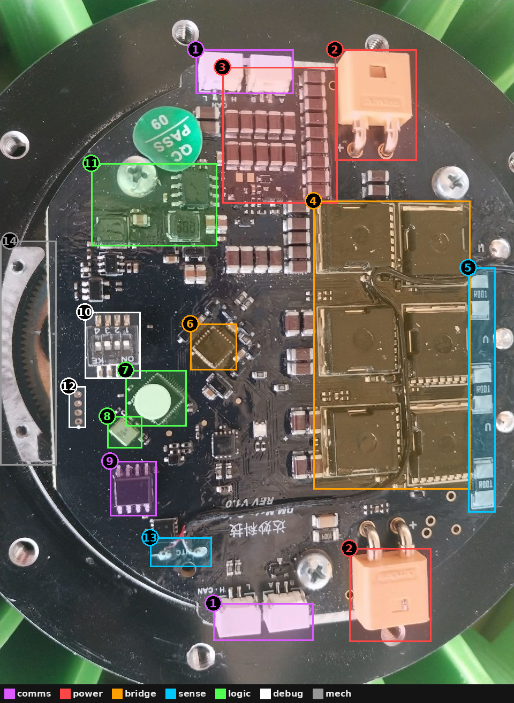
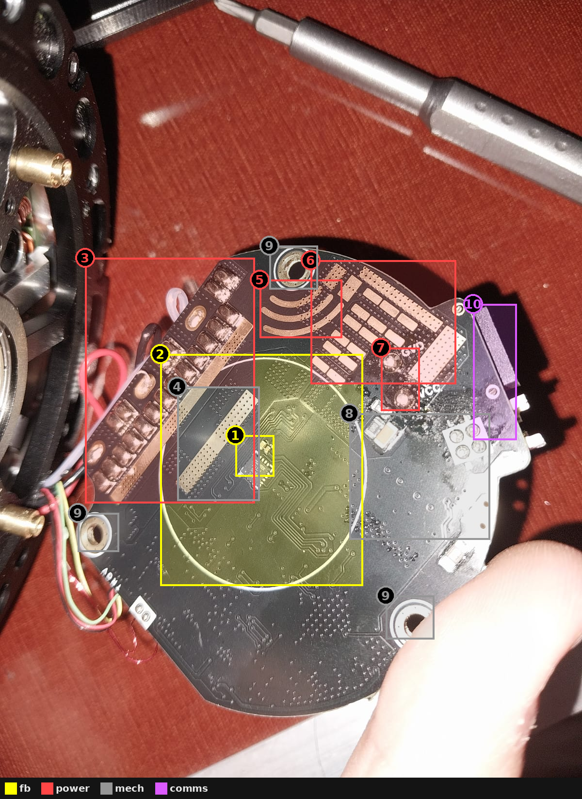
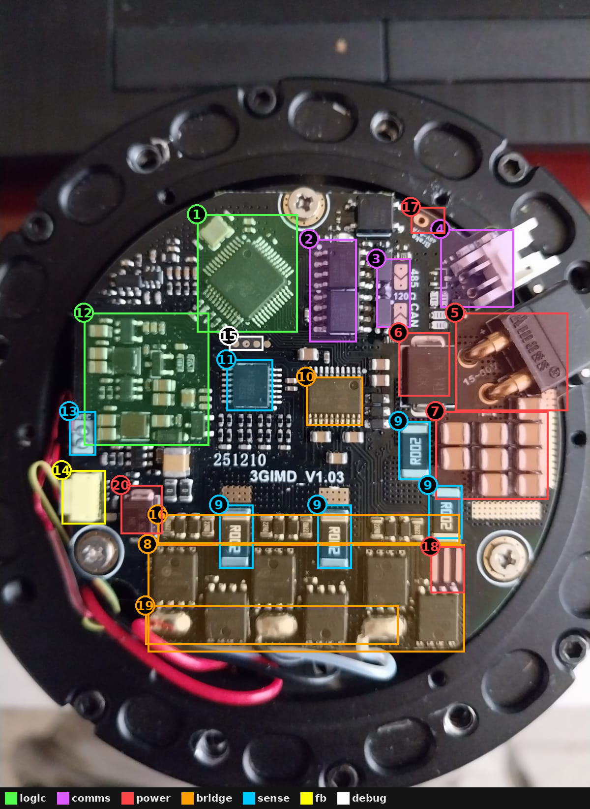
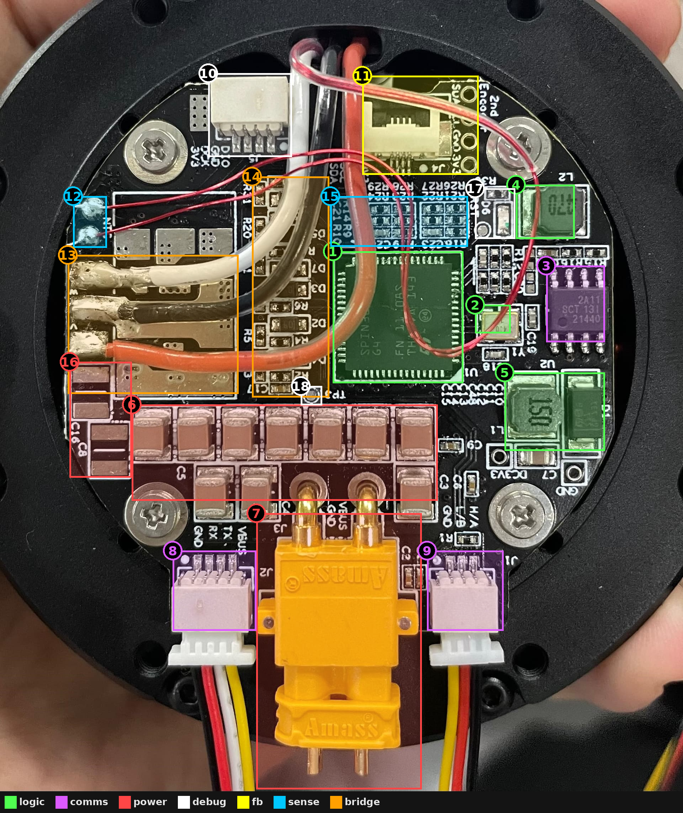
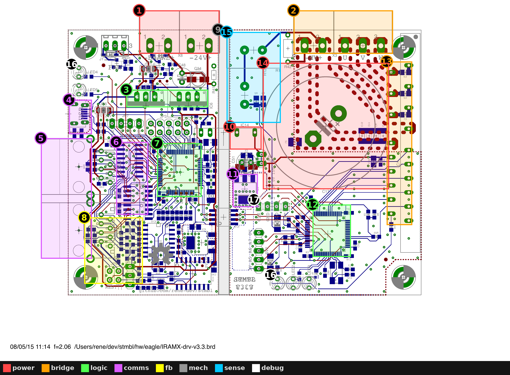

# 13 - The reference boards, explained box by box

Read modules 00-12 first; this module is the "exam". For each highlighted box,
try to say what it is **before** reading the explanation.

Colour key (same on every image): red = power, orange = bridge/gate drive,
cyan = sensing, green = logic, purple = comms, yellow = position feedback,
white = debug/indicators, grey = mechanical/thermal.

Parts marked *likely* are identified from package, location and neighbours
because the marking is unreadable or covered.

---

## A. DM board, top side (`SteadyWin_Clone_Photo_1.jpg`)

The silkscreen says "达妙科技" (DaMiao Technology) and "REV V1.0", so this is a
DaMiao-style (DM-J series) controller, a close relative of the SteadyWin
designs. It is a **high-current** design: big MOSFET packages, many caps.

| # | What | Why it is there |
|---|------|-----------------|
| 1 | Two pairs of 2-pin connectors: "CAN L H" and "A B" at the top, the same at the bottom | **Daisy-chained bus**: in and out connectors wired in parallel so joints can be chained. "A/B" is the typical naming for RS-485 (or a second bus). Module 08. |
| 2 | Two **XT30** connectors (Amass), marked + | Power in and power out (daisy-chain power to the next joint). Module 07. |
| 3 | Big bank of brown **MLCCs** (~25 of them) next to the power input | DC-link capacitance: supplies the ripple current of the bridges and absorbs regen spikes. Many parallel MLCCs = low ESR/ESL and compensates DC-bias derating. Module 07 §7. |
| 4 | **Six large power MOSFETs** (big exposed-tab packages, TOLL/D²PAK-class) in a 2×3 grid | Three half-bridges (one per phase). Big packages = low Rds(on) and good heat transfer into the PCB. Black glue holds a wire in place (vibration strain relief). Module 03. |
| 5 | Three **R001** (1 mΩ) 2512 resistors next to the "U" labels | Current-sense shunts, located at the phase outputs -> most likely **inline** phase sensing. Module 05. |
| 6 | Square QFN rotated 45°, surrounded by small caps | *Likely* the **3-phase gate driver** (sits between the MCU and the FETs; the many small caps around it = bootstrap/VCP/decoupling). Rotated to make the routing to all six FETs short. Module 04. |
| 7 | LQFP chip with a white sticker | The **MCU**. The sticker hides the part number (common practice to make cloning harder). |
| 8 | Metal crystal / oscillator | Precise clock for the MCU: needed for exact PWM timing and for CAN bit timing (CAN needs a precise clock; internal RC oscillators are not accurate enough). |
| 9 | SOIC-8 chip near the bottom bus connectors | *Likely* the **CAN transceiver**. |
| 10 | 4-position DIP switch, "ON / KE" | Configuration: CAN ID bits and/or bus termination on/off. Module 08 §2. |
| 11 | Two power inductors + small SOT/DFN ICs | **Logic power supply** (buck converter(s) from the bus voltage to 5 V/3.3 V). Module 07 §8. |
| 12 | Column of 4 small round pads | Programming/debug pads (SWD for the MCU: typically 3V3, SWDIO, SWCLK, GND). Module 12. |
| 13 | Thin wire soldered to pads marked "NTC" | **Motor temperature sensor** (a thermistor glued into the winding). Module 09. |
| 14 | Toothed ring at the left edge | Not part of the board - the planetary **gearbox ring gear** of the actuator. Shows how tightly the board is packaged into the housing. |

Also notice: the green "QC PASS" sticker; the round shape that follows the
housing; FETs on the right edge closest to the housing wall (heat path).

---

## B. DM board, bottom side (`SteadyWin_Clone_Photo_2.png`)

This side faces the motor. It's mostly about **feedback, current and heat**.

| # | What | Why it is there |
|---|------|-----------------|
| 1 | Small QFN in the centre | **On-axis magnetic encoder IC** (marking only partly legible). It sits exactly on the rotation axis, facing a diametric magnet on the rotor/sun-gear shaft. Module 06. |
| 2 | White circle around it | **Magnet / encoder keep-out zone** marking. Only signal traces inside; no high-current copper (its magnetic field would disturb the encoder). |
| 3 | Rows of tinned (silver) pads and stripes | High-current copper with **solder-mask removed and extra solder** added -> lower resistance for phase/bus currents. Also where phase wires get soldered. Module 11 §4. |
| 4 | Gold rectangle with dense via grid | **Thermal interface pad**: exposed copper connected by many thermal vias to the hot side. It presses on the housing through a thermal pad. Module 09 §3. |
| 5 | Curved exposed copper arcs | More exposed/augmented power copper, shaped to fit the round board. |
| 6 | Many exposed rectangular pads, "GND"/"VCC" | Power input area: big copper pads (and possibly bottom-side capacitors) for the bus. |
| 7 | GND / VCC through-hole pads | Power connection points (the XT30 or bus wires on the other side come through here). |
| 8 | Field of hundreds of small vias | **Via stitching**: ties ground pours on all layers together - lower ground impedance, less noise, better heat spreading. Module 11 §5. |
| 9 | Plated mounting holes with exposed rings | Mechanical mounting + grounding to the housing + some heat conduction. |
| 10 | Connector at the edge | Board-to-board / cable connector (seen from the side). |

---

## C. "3GIMD V1.03" board (`SteadyWin_Clone_Photo_3.png`, photo 4 is the same board)

A compact **15-60 V** design (printed next to the power connector) with both
CAN and RS-485. Very clean layout - a good model for your board.

| # | What | Why it is there |
|---|------|-----------------|
| 1 | LQFP-48 MCU + crystal (top) | Main controller. Placed farthest from the power stage. |
| 2 | Two SOIC-8 chips | **CAN transceiver and RS-485 transceiver** (next to the "485 / CAN" jumpers). |
| 3 | Solder jumpers labelled "485 120Ω CAN" | **Termination resistors you enable by bridging a jumper** - only the last node on a bus should terminate. Module 08. |
| 4 | White 4-pin connector | Communication connector (bus + probably power/GND). |
| 5 | Power input, "15-60V" | Bus voltage input (Amass connector). The wide range tells you: 80-100 V-rated FETs or careful 60 V design, and a buck that accepts 60 V+. |
| 6 | Large SMC/SMB diode next to the input | **TVS diode** clamping input surges/regen spikes. Module 07 §4. |
| 7 | 3×3 grid of large MLCCs | DC-link capacitor bank, right at the input and close to the bridges. |
| 8 | **Six PDFN 5×6 MOSFETs** in a row at the bottom | Three half-bridges. Small, flat, low Rds(on), exposed pads into PCB copper. |
| 9 | Four **R002** (2 mΩ) shunts | Current sensing. Three near the bridges = **low-side phase shunts**, the one near the input is likely a **DC-bus shunt** (protection/power measurement). Module 05. |
| 10 | TSSOP chip with exposed pad | *Likely* the **3-phase gate driver** (between MCU and FETs). |
| 11 | TSSOP-14 "RS724" (readable on photo 4) | **Quad op-amp** - the current-sense amplifiers for the shunts (plus maybe Vbus buffer). The small resistor/cap network around it sets gain and filtering. Module 05 §3. |
| 12 | Inductors, diodes, caps on the left | **Logic power supply** (buck from 15-60 V to low voltage, then LDO). Kept away from the current-sense area. |
| 13 | 2 pads "NTC" with red/yellow wires | Motor winding thermistor. |
| 14 | Small white connector | *Likely* aux/encoder/temperature connector. |
| 15 | Row of 4 gold dots under the MCU | **SWD programming pads** (for a pogo-pin jig). |
| 16 | Row of small resistors/caps above the FETs | Gate resistors, gate pull-downs, bootstrap parts - placed right at the FET gates. |
| 17 | Two pads labelled "Brake" (40 V 1 A printed) | Output for an **electromagnetic holding brake** (a FET switch + flyback diode on the board). |
| 18 | Three exposed copper stripes | Solder-augmented high-current path. |
| 19 | Phase wire solder pads (U V W wires) | Motor connection - direct solder, no connector (connectors at 20+ A are big and unreliable under vibration). |
| 20 | SMB diode bottom-left | *Likely* part of the logic power (buck rectifier or reverse protection for the logic rail). |

---

## D. SteadyWin GIM8115 board (`GIM_8115-9_Photo.jpeg`)

Interesting because it uses an **integrated MCU + gate driver** chip and
clearly labels its interfaces.

| # | What | Why it is there |
|---|------|-----------------|
| 1 | Large QFN marked "SPIN... G4" | **STSPIN32G4**: an STM32G431 MCU + a 3-phase gate driver + buck controller + LDOs in one package. Replaces MCU + gate driver + part of the power supply. Its MCU has hardware-triggered ADCs and built-in op-amps -> great current sensing. |
| 2 | Crystal Y1, "24.0" | 24 MHz clock for the MCU (accurate CAN/PWM timing). |
| 3 | SOIC-8 "SCT..." | *Likely* the **CAN (or RS-485) transceiver**, next to bus connector J1. |
| 4 | L2 "470" (47 µH) inductor | Part of the logic power supply. |
| 5 | L1 "150" (15 µH) + D1 Schottky | **Buck converter** (the STSPIN32G4 has a buck *controller* that needs this external inductor + diode). "DC3V3" label nearby. |
| 6 | Row of 7+3 large MLCCs | DC-link capacitor bank. |
| 7 | **XT30** (Amass) | Power input. |
| 8 | J2: "VBUS TX RX GND" | **UART** connector (serial command/debug). |
| 9 | J1: "H/A L/B GND" | **CAN_H/CAN_L or RS-485 A/B** - one footprint, one of the two transceiver options. |
| 10 | J5: "DIO GND DCK 3V3" | **SWD programming header** (SWDIO, SWCLK). |
| 11 | J4: "SCL SDA GND 3V3", labelled "**2nd Encoder**" | **Output-side encoder** connector (I²C) for a **dual-encoder** actuator. Exactly the "multiple feedback" idea from module 06 §6. |
| 12 | Pads "NTC" with thin red wires | Motor winding thermistor. |
| 13 | Phase A/B/C wire pads + power copper | Motor phase connections. The MOSFETs are on the hidden (other) side under this area - you can see big pads and vias. |
| 14 | Column of R and D2-D7 | Gate resistors with **turn-off diodes** (one diode per FET = 6) -> slow-ish turn-on, fast turn-off, protects against dV/dt-induced turn-on. Module 03 §4, module 04 §3. |
| 15 | Grid of small resistors/caps (R21-R29...) | *Likely* current-sense / voltage-divider networks feeding the STSPIN32G4's op-amps and ADC. |
| 16 | Large pads C16 / C8 | Big capacitors (bus/regulator). |
| 17 | D6 LED + "RST" pad | Status indicator and reset access. |
| 18 | TP3 | Test point. |

---

## E. STMBL IRAMX driver (open-source; `IRAMX-drv-v3.3sch.pdf` / `...brd.pdf`)

Different world: an **industrial servo drive for up to ~400 V DC bus** (mains
powered), not a compact actuator. Worth studying for its **structure and
isolation**, not its parts.

Full schematic copy: [images/IRAMX_schematic.png](images/IRAMX_schematic.png).

| # | What | Why it is there |
|---|------|-----------------|
| 1 | 24 V input + BRAKE + FAN terminals | Low-voltage logic supply and two auxiliary outputs, switched by small IRLML6344 MOSFETs (Q1, Q3) with **flyback diodes** (D3, D4) because brakes/fans are inductive. |
| 2 | HV+ and U V W terminals | High-voltage DC bus in, motor out. |
| 3 | 7812 / 78xx linear regulators (TO-220) | 24 V -> 12 V -> 5 V; then 1117 LDO -> 3.3 V. Simple linear chain (low current, so heat is acceptable here). |
| 4 | USB receptacle | USB to the STM32F405 (config/debug). |
| 5 | Two RJ45 jacks ("CMD" and "FB") | Command input and feedback (encoder) connections over twisted-pair cables. |
| 6 | 8-pin RS-485 transceivers + 26LS32-type line receiver ("1A 1B 1Y...") | Differential receivers for encoder/command signals over long cables (RS-422/485). |
| 7 | **STM32F405** | Main servo controller on the low-voltage side: position/velocity loops, feedback decoding. |
| 8 | TCA0372 power op-amps + passives | **Resolver / sin-cos encoder front end**: drives the resolver excitation and amplifies the sine/cosine signals. |
| 9 | Gap in the copper between the two halves | **Galvanic isolation barrier**: no copper crosses; only isolated parts bridge it. Protects the user-facing logic (USB!) from the 400 V side. |
| 10 | rk-2415s isolated DC-DC | Makes isolated 15 V for the high-voltage side from the 24 V logic supply. |
| 11 | Digital isolator (VDD1/VDD2, IN/OUT) | Carries UART data across the barrier. |
| 12 | **STM32F103** | Second MCU on the high-voltage side: generates PWM, measures current (shunt + "AMP"), bus voltage ("VLT") and temperature ("VTH") right where the signals are, sends results across the isolator. |
| 13 | IRAMX16UP60B module pins (SIP at the board edge) | **Integrated power module**: 6 IGBTs + gate driver + bootstrap in one package, 600 V class. Sits at the board edge to bolt onto a heatsink. |
| 14 | Large circle | Footprint of the big **DC-bus electrolytic capacitor**. |
| 15 | Large-body resistors | High-voltage resistors (bus voltage divider / sensing): physically big for voltage rating and creepage, not for power. Plus a varistor on the bus for surge protection. |
| 16 | LEDs (both sides) | Status/fault on each side. |
| 17 | SWD header (high-voltage side) | Programming the F103 (only with HV off!). |

Lessons for your 24 V board:

- The **split of jobs** (one MCU near the power stage doing PWM + current, one
  doing high-level control and comms) is a valid architecture - remember it if
  the ESP32-S3 alone isn't enough.
- **Flyback diodes** on every inductive load switch.
- **Differential signalling** for anything on a long cable.
- Isolation is needed for mains-level voltages; for a 24 V actuator it's
  optional, but **USB isolation during development** is still a good idea.

---

## Self-test

Cover the tables and answer for each board:

1. Where does power enter, and what is the first protection it meets?
2. Which parts form the three half-bridges? Where are their bus capacitors?
3. Low-side, inline or bus shunts?
4. Where is the gate driver, and how far is it from the FETs?
5. Where is the encoder, and how is high current kept away from it?
6. How does the board talk to the robot? How is termination selected?
7. How do you program it?
8. Where does the heat go?

If you can answer all eight for all four boards, you're ready for
[14 - your board](14_Your_Board_Checklist.md).
